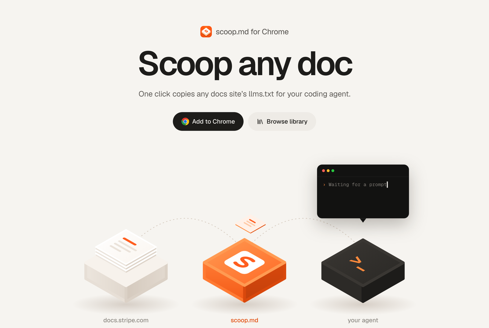
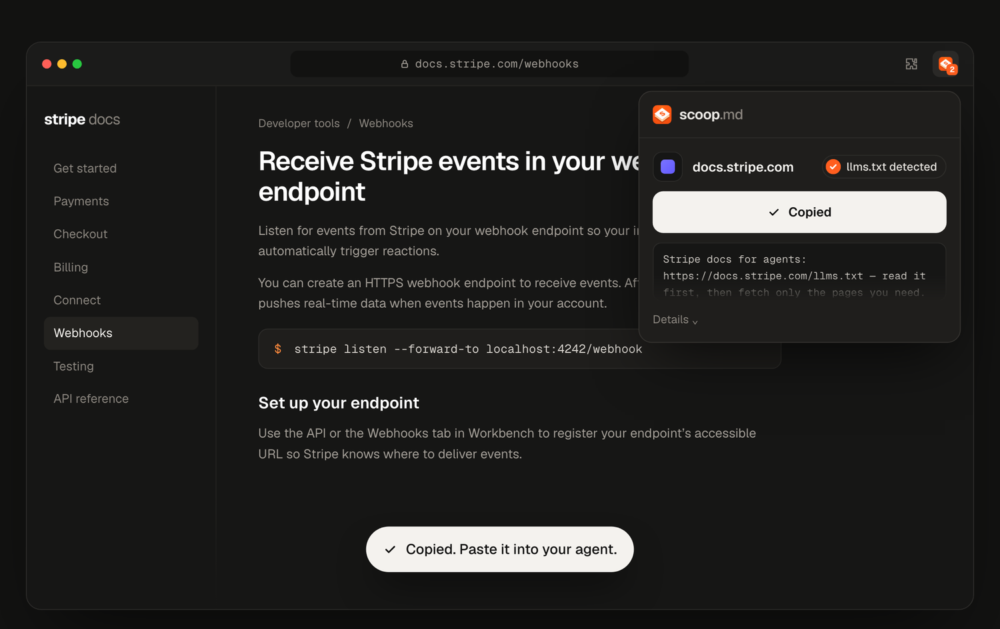
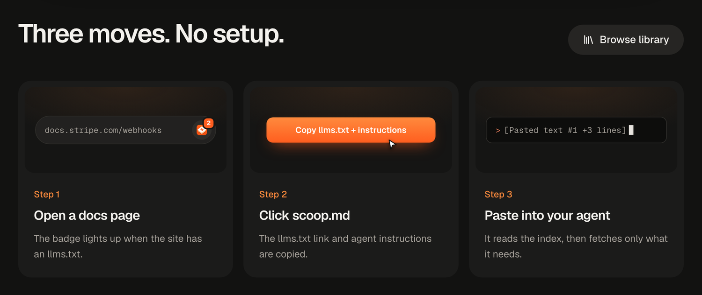
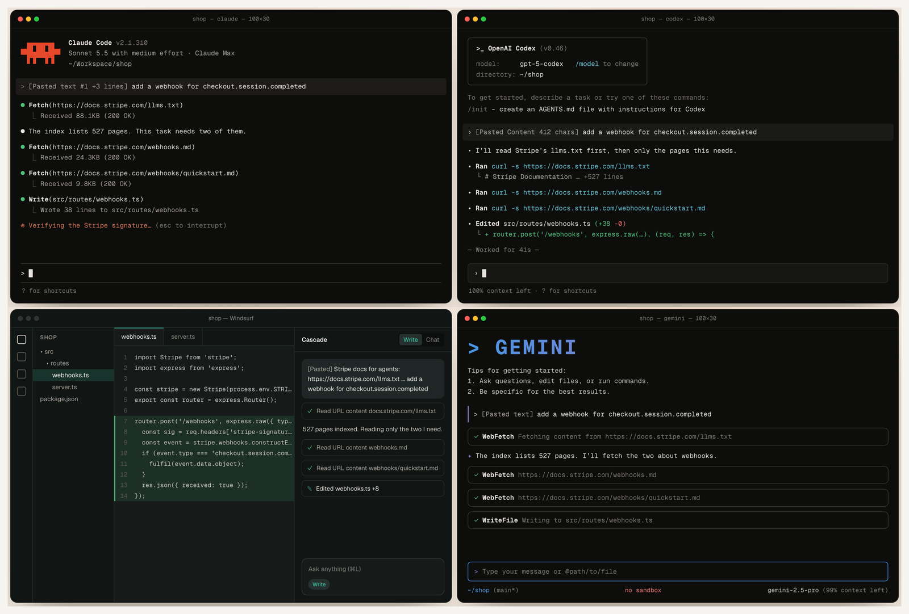

<p align="center">
  <b>One click copies any docs site's <code>llms.txt</code> for your coding agent.</b>
</p>

<p align="center">
  <a href="https://chromewebstore.google.com/detail/ccfbndgiomnmpanklpmadpapkocihfpd"></a>
  <a href="https://scoop.md"></a>
  <a href="LICENSE"></a>
</p>

<p align="center">
  <a href="#how-it-works">How it works</a> ·
  <a href="#works-with-your-agent">Agents</a> ·
  <a href="#run-it">Run it</a> ·
  <a href="#under-the-hood">Under the hood</a> ·
  <a href="docs/BACKEND.md">API</a>
</p>

<p align="center">
  
</p>

## What it is

A "Scoop to agent" button that works on any documentation site. Click it and the site's `llms.txt` and its instructions for agents land on your clipboard, as a short prompt to paste into Claude Code, Codex, Cursor or any other coding agent. The agent reads the index and fetches only the pages it needs, so you never paste a wall of docs.

- **One click.** The toolbar icon, or <kbd>Alt</kbd> + <kbd>Shift</kbd> + <kbd>C</kbd> on any docs page.
- **Just the map.** A short prompt with the `llms.txt` link and the site's own instructions for agents, not the docs.
- **Any developer site.** If a site has no `llms.txt`, scoop.md prepares one.
- **Private.** The extension never reads the page you're on. It asks for the site's `llms.txt` by its address.

<p align="center">
  
</p>

## How it works

<p align="center">
  
</p>

1. **Open a docs page.** The toolbar badge lights up when the site has an `llms.txt` (**1**), or an `llms.txt` plus instructions for agents (**2**).
2. **Click scoop.md.** The `llms.txt` link and the agent instructions are copied.
3. **Paste into your agent.** It reads the index, then fetches only what the task needs.

## Works with your agent

The same prompt, pasted into six agents. Each reads the index, fetches two pages out of 527, and writes the code.

<p align="center">
  
</p>

<p align="center">Claude Code · Codex · Cursor · GitHub Copilot · Windsurf · Gemini CLI</p>

## Run it

```sh
npm test                 # unit, HTTP and popup tests
npm run server           # shared library on http://localhost:8787/v1
npm run probe -- https://docs.stripe.com/webhooks   # see what a site publishes
npm run pack:extension   # dist/scoop.md-extension-<version>.zip for the Chrome Web Store
npm run icons            # redraw extension/icons (needs python3 + Pillow)
```

Load the extension in Chrome: `chrome://extensions` → Developer mode → **Load unpacked** → pick the `extension/` folder. Click the toolbar icon on any docs page, or press Alt+Shift+C.

The library is always `https://api.scoop.md/v1`; users can't change it. The options page has usage statistics on or off, the theme and the keyboard shortcut. If the library can't be reached, the extension looks for the site's own llms.txt; failing that, it says so, with Retry.

To test against `npm run server`, load the extension unpacked and set a local override from the popup's DevTools console (right-click the popup → Inspect):

```js
chrome.storage.local.set({ devLibraryUrl: 'http://localhost:8787/v1' })  // undo: chrome.storage.local.remove('devLibraryUrl')
```

Only unpacked installs (`chrome.management.getSelf()` → `installType: "development"`) read `devLibraryUrl`; Web Store installs ignore it.

## Under the hood

<details>
<summary><b>The popup and the toolbar badge</b></summary>

### The popup (0.6)

Opening the popup asks `GET /v1/llms?url=<page origin + first path segment>` (e.g. `https://docs.stripe.com/webhooks`; 5 s) and copies at once. A live elapsed time ticks under the loader (and in the meta line while scoop.md prepares an llms.txt), and the final time stays in the meta ("found in 1.2s", "prepared in 4.6s"). For a developer site it shows exactly two things: **llms.txt** (a chip, a "by scoop.md" badge when scoop.md prepared it, "412 pages · checked today", and a read-only monospace field with the file's URL, cut in the middle, with an open ↗ icon and a copy icon) and **Instructions for agents** (verbatim lines from the llms.txt that tell agents how to install, set up and use the product, from `agentInstructions`; verbatim, collapsed after about 4 lines with "Show more", with a copy icon). The big button ("Copy llms.txt", or "Copy llms.txt + instructions") copies the server's `prompt` as given (it carries the instructions excerpt), e.g. `Stripe docs for agents: https://docs.stripe.com/llms.txt — read it first, then fetch only the pages you need.` A scoop.md llms.txt still being built says "Preparing…": its URL already works, so it is copied at once, and the popup asks again every `retryAfterMs` until it's ready. Not a developer site: "This isn't a developer website. scoop.md is for developer docs." and nothing else. Long instructions collapse behind "Show all ⌄". If the library doesn't answer, the site's own llms.txt, verified in the browser (an H1 and a link), gives the same prompt; otherwise "Couldn't reach scoop.md" with Retry. `llms_copy { site, source: site|scoop|fallback, trigger: auto|button }` is recorded.

### The toolbar badge

The toolbar badge shows, per tab, "1" when the site has an llms.txt (its own or a ready one prepared by scoop.md) and "2" when it also has instructions for agents, in the scoop orange with white text; nothing when unknown, not a developer site or still being prepared. It is looked up on the device in `GET /v1/sites/index` (`llms: { host: 1 | 2 }`, downloaded every 6 hours with If-None-Match; no request per page; an older list without it shows nothing) and in what the popup learned from `/v1/llms` for sites you opened it on (7 days). Background indexing shows only in the popup. The popup's **Overview** and **Search** tabs work on indexed sites: the topics and llms.txt within the 16k budget ("Copy full llms.txt" when it's longer), or search with checkboxes, "Copy selected" and "Copy all"; each shows the ~tokens it copies.

The extension never reads the page you're on and shares nothing: it asks for the site's llms.txt by its address. (Versions before 0.6.0 copied the page itself and shared public docs with the library; the backend still serves those routes.)

</details>

<details>
<summary><b>Layout, library API and known limits</b></summary>

### Layout

```
extension/            Chrome MV3 extension
  lib/discover.js     finds a site's llms.txt when the library doesn't answer (no credentials)
  lib/extract.js      HTML → Markdown (used by the backend crawler) and tracking-parameter stripping
  lib/library.js      api.scoop.md/v1 client; never throws, short timeouts
  lib/package.js      llms.txt verification; the page packages the backend builds
  lib/badge.js        the per-tab "1"/"2" toolbar badge and the downloaded sites index
  lib/ux.js           popup timing (loader minimum, copied moment, the Copied label)
  popup.js            the popup: the site's llms.txt and instructions, one Copy
  STORE.md            Chrome Web Store listing, permissions, data disclosures
server/               shared library (Node, no dependencies, JSON file store)
backend/              api.scoop.md: Cloudflare Worker (v1 API, CrawlSite Workflow)
crawler/              Playwright crawler for client-rendered docs (runs in an E2B sandbox)
scripts/probe.js      runs discovery against real sites
test/                 node:test suites
```

### Library API

The extension talks to the v1 API specified in [docs/BACKEND.md](docs/BACKEND.md): `GET /v1/skills/best?site=`, `POST /v1/skills` (sections are verified against their live sources), `POST /v1/skills/:id/feedback` and `POST /v1/reports`. POSTs carry an anonymous install ID (`X-Scoop-Install`).

### Known limits (prototype)

- A site is identified by hostname. Different products on one host share a skill.
- "Worked" is a single button press, one vote per install.
- Extraction is heuristic: it takes the smallest element around the page's `<h1>` that holds most of the prose.

</details>

## License

MIT. See [LICENSE](LICENSE). Agent logos in `site/public/agents/` come from [Simple Icons](https://simpleicons.org) (CC0); the brands belong to their owners.
